<div align="center">


# Envelope

**A fast, beautiful mail and calendar client for Linux.**

Gmail, Microsoft 365, Outlook.com, Exchange, iCloud, Yahoo, Fastmail and any IMAP server — with a real calendar, tasks,<br>
instant offline search, a keyboard-first workflow and optional AI that runs on the provider *you* choose.

[](https://github.com/burakgon/envelope/actions/workflows/ci.yml)
[](LICENSE)
[](crates)
[](src)

[**Try the live demo**](https://burakgon.github.io/envelope/) · [Install](#install) · [Features](#features) · [Build from source](#build-from-source) · [Contributing](CONTRIBUTING.md)

<br>

<picture>
  <source media="(prefers-color-scheme: dark)" srcset="docs/screenshots/inbox-dark.png">
  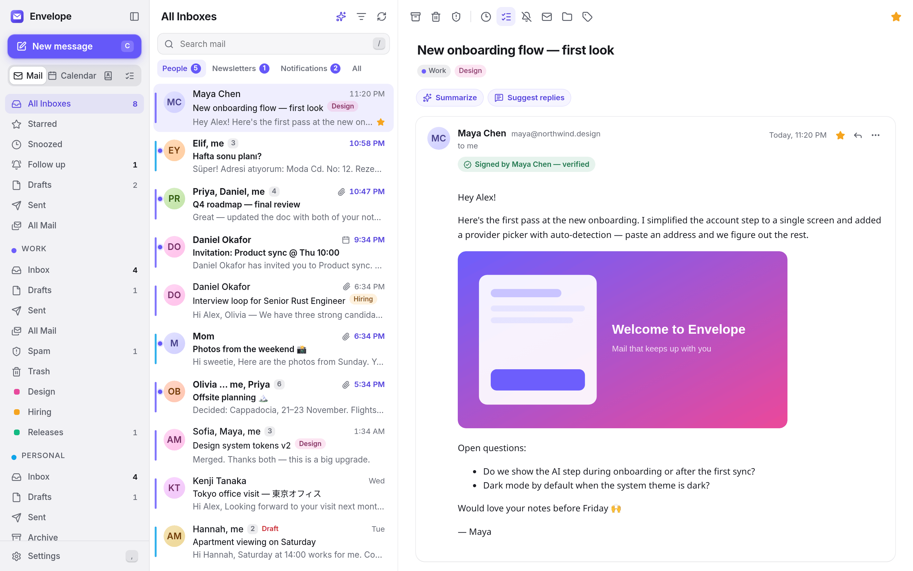
</picture>

</div>

## Why Envelope?

Desktop mail on Linux has long meant choosing between powerful-but-dated and pretty-but-slow. Envelope is an attempt at both: a native Rust engine that keeps your mail in a local SQLite database, and a carefully designed interface on top of it.

- **Instant.** Lists are read from a local database with precomputed thread aggregates, so opening a folder, switching tabs and searching take milliseconds — online or offline. Every action is optimistic and queued, so the UI never waits for the server.
- **Keyboard-first.** Gmail-style shortcuts (`j`/`k`, `e`, `#`, `r`, `c`, `g i` …), menus and dialogs that work from the keyboard, Space to read on, and a command palette (`Ctrl K`) that can do everything the mouse can.
- **A real calendar.** Day, work week, week, month and agenda views, drag to create, move and resize, recurring events with "this / following / all" edits, invitations with RSVP and conflict detection, a scheduling assistant, subscriptions and reminders — synced both ways with CalDAV, Google Calendar, Microsoft 365 and Exchange.
- **Tasks where your mail is.** Turn a message into a task with one key, type "call Maya tomorrow 3pm !" and get a due time and a star, and see what's due in your calendar — synced with Google Tasks, Microsoft To Do, Exchange and CalDAV.
- **Private by design.** No telemetry, no proxy servers, no account with us. Your mail goes straight from your provider to your disk. Remote images and trackers are blocked until you allow them, messages render in a locked-down sandbox, and OpenPGP encryption sets itself up with Autocrypt. The one request Envelope makes on its own is a daily look at GitHub's list of releases, which you can turn off.
- **AI you control.** Summaries, smart replies, writing help, translation and "ask your inbox" — using OpenRouter, OpenAI, Anthropic, Google Gemini, Groq, Mistral, a local Ollama or LM Studio model, or any OpenAI-compatible endpoint. Off until you turn it on, and your API keys live in the system keyring.

<p align="center">
  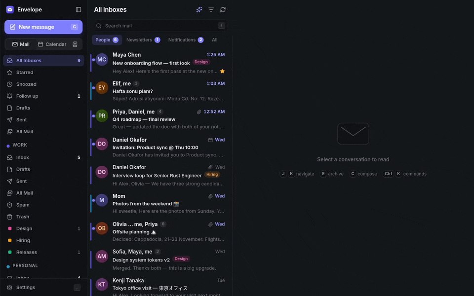
</p>

## Features

<table>
<tr>
<td width="50%">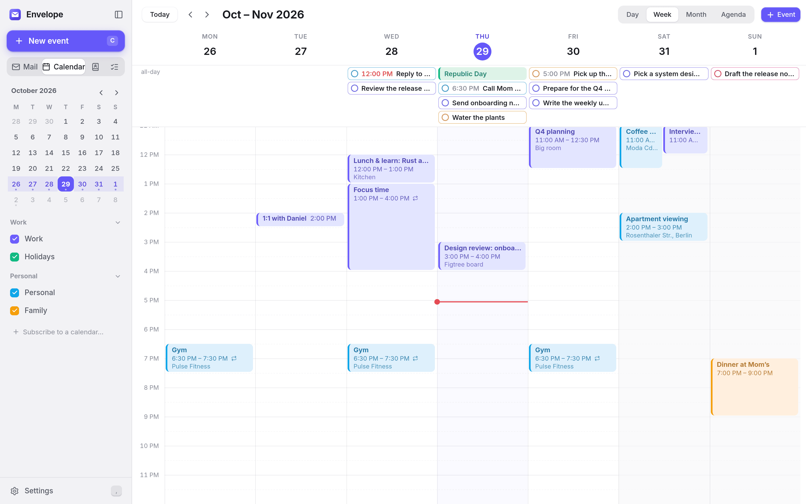</td>
<td width="50%">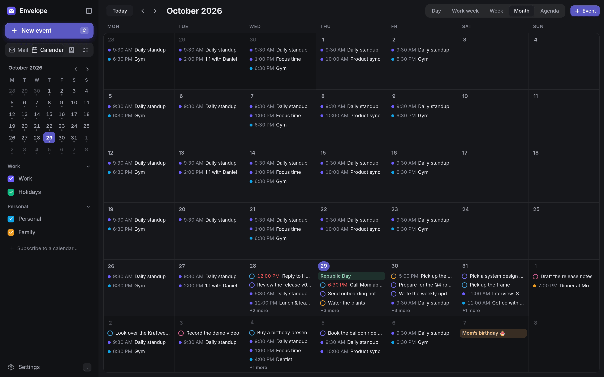</td>
</tr>
<tr>
<td width="50%">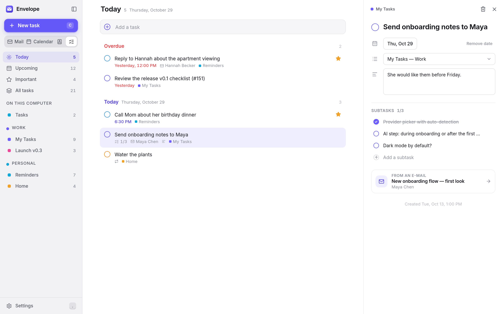</td>
<td width="50%">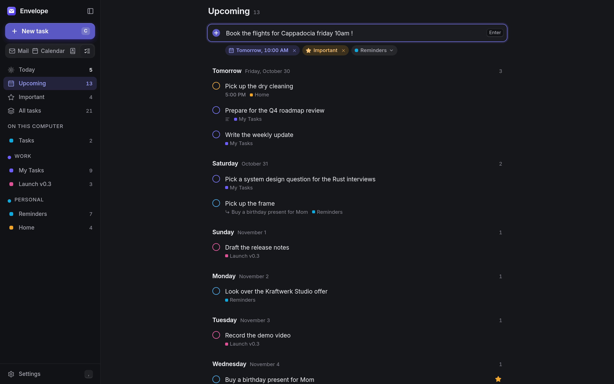</td>
</tr>
<tr>
<td width="50%">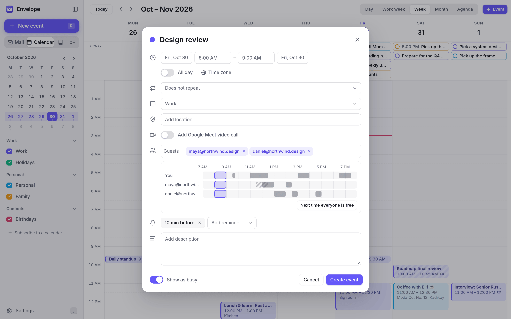</td>
<td width="50%">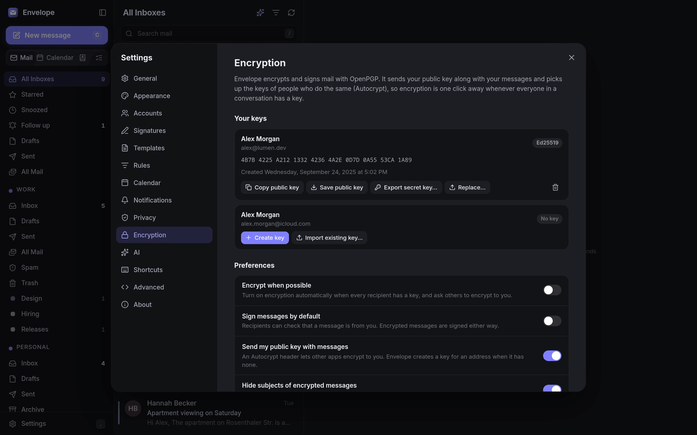</td>
</tr>
<tr>
<td width="50%">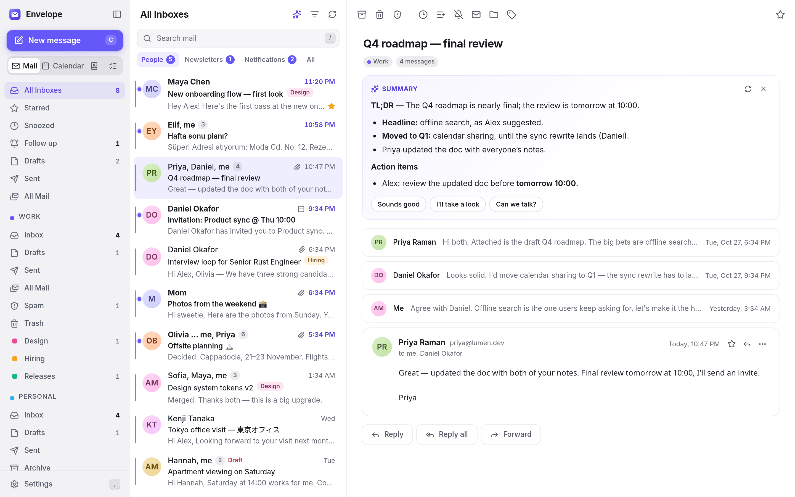</td>
<td width="50%">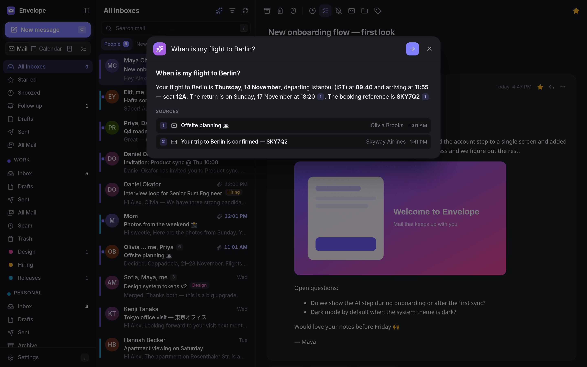</td>
</tr>
<tr>
<td width="50%">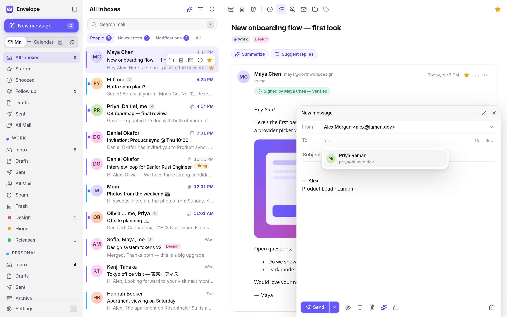</td>
<td width="50%">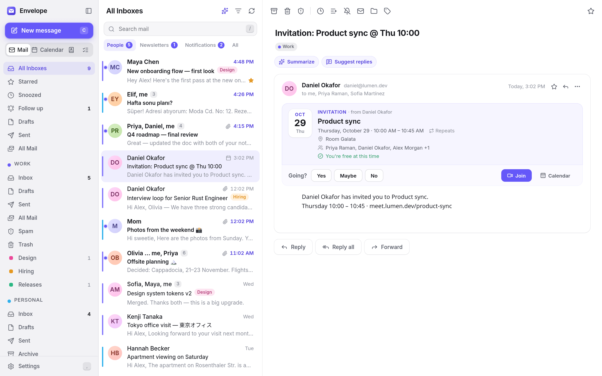</td>
</tr>
<tr>
<td width="50%">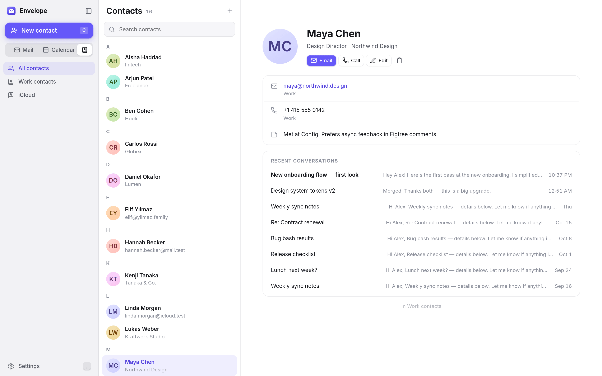</td>
<td width="50%">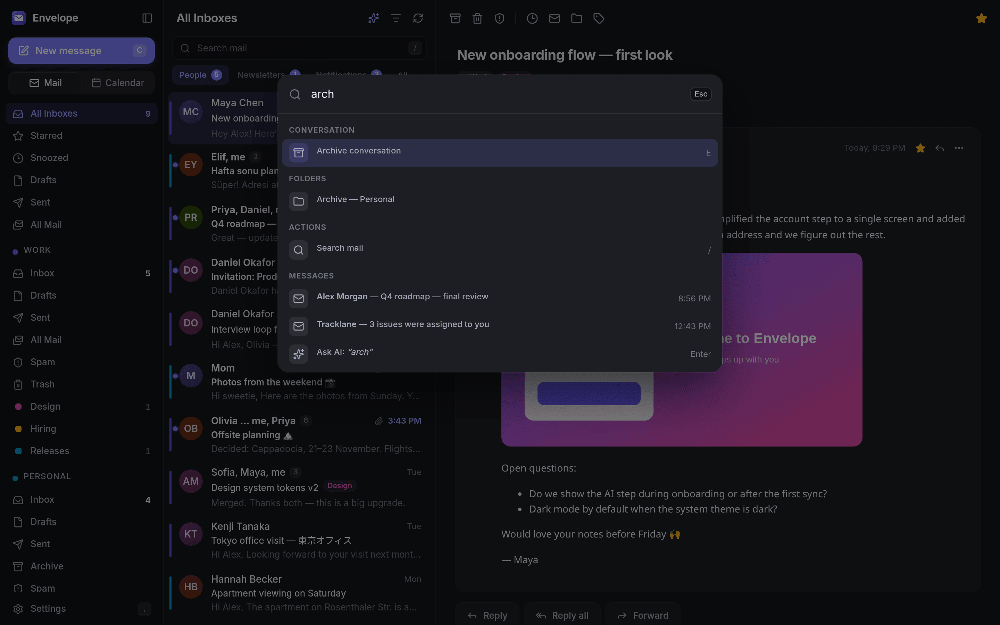</td>
</tr>
</table>

### Mail
- **Unified inbox** across all accounts, plus per-account folders and Gmail labels (with colors), drag and drop to move or label. Create, rename, nest, recolor and delete folders and labels (Outlook categories too), and empty Trash and Spam.
- **Conversations** threaded the way you expect, with quoted text and signatures folded away — or every message on a row of its own, if you prefer.
- **Your layout:** the reading pane on the right, below the list or off, lists sorted newest first, oldest first or by sender (each folder keeping its own order), and conversations and messages being written in windows of their own.
- **Split inbox**: *People*, *Newsletters* and *Notifications* tabs, computed locally.
- **Subscriptions**: every newsletter and mailing list in one list — unsubscribe, archive what they left in the inbox, or delete it all, sender by sender.
- **VIPs**: the people who matter most get a mailbox of their own, a crown on their messages, `is:vip` in search, and can be the only mail that notifies.
- **Instant full-text search** (SQLite FTS5) with operators — `from:`, `to:`, `subject:`, `has:attachment`, `is:unread`, `before:`, `after:` … — and natural-language search through AI if enabled. Search options write the query for you, `from:` and `to:` suggest people, recent searches are a keystroke away, and **saved searches** sit in the sidebar.
- **Composer** with rich text (colors, sizes, alignment, inline pictures), attachments (drag and drop or paste), recipient autocomplete, spell checking, multiple identities and rich signatures, **templates**, **undo send**, **scheduled send** (with an outbox to review, send now or edit), forward as attachment, and drafts that sync to the server and open for editing on any device. It asks before sending to an address that looks wrong, or without the attachment the text mentions.
- **Snooze**, star, archive, **mute**, report spam and *not spam*, **block senders**, bulk actions and **undo** for everything.
- **Follow-up reminders**: get nudged when nobody replied to a message you sent — then mark it done or have it come back later.
- **Rules** that file, label, mark or silence new mail as it arrives, and run on the mail already there when you want — for every kind of account.
- **Automatic replies** (out of office) for Microsoft 365, Exchange, Gmail and IMAP servers with Sieve, with optional dates and a reminder while they are on.
- **Safe HTML rendering** in a sandboxed frame with remote content blocking, tracking-pixel removal, dark-mode adaptation for plain emails and `cid:` inline images. Links show where they really go, and warn when their text names another site.
- **End-to-end encryption** with OpenPGP that sets itself up: keys are created and exchanged with Autocrypt and found in the recipient's Web Key Directory, the lock in the composer turns on when everyone has a key, and messages show who signed them. Experts can import, export and verify keys. **S/MIME** for Outlook and company mail too: import your certificate (`.p12` or `.pfx`) to sign and decrypt, the certificates of people who send you signed mail are kept for encrypting to them, and signatures are checked up to the authorities your system trusts — see [docs/ENCRYPTION.md](docs/ENCRYPTION.md).
- **Offline-first**: read, search, triage and write without a connection; changes sync when you're back.
- **Push mail** via IMAP IDLE, CONDSTORE/QRESYNC for fast resyncs, Gmail extensions (labels, thread ids, `X-GM-RAW` search) when talking to Gmail.
- Desktop notifications with Archive and Mark as Read buttons and the desktop's new-mail sound — for all new mail, only mail from people, only VIPs, or nothing, per account — an unread badge, `mailto:` handling, **Save all** for attachments, and saved messages (`.eml`), calendar files (`.ics`) and contact cards (`.vcf`, `.csv`) open straight from your file manager.

### Calendar
- Day, work week, week, month and agenda views; mini month; per-calendar visibility and colors; a second time zone beside the hours; week numbers if you count in them.
- **Birthdays** from your address books in a calendar of their own, with the age each one turns.
- Drag to create, drag to move (across days), drag to resize; double-click in month view to add.
- Recurring events with editing scopes (*this event*, *this and following*, *all events*), and custom repeats: every so many days, weeks, months or years, several weekdays, "the second Tuesday" or "the last Friday", until a date or a number of times.
- Events in a time zone of their own, kept by every provider.
- Guests, RSVP, Google Meet / Teams links and one-click **Join**, reminders, busy/free.
- **Scheduling assistant**: see when guests are busy (Google, Microsoft 365 and Exchange) and jump to the next time everyone is free.
- Invitations in mail (iTIP) become cards with **Yes / Maybe / No**, a conflict check against your calendar, replies sent to the organizer and **Propose new time**; a time proposed for your own meeting is accepted or declined from the mail.
- Two-way sync: **CalDAV** (iCloud, Fastmail, Nextcloud, Radicale, …), **Google Calendar**, **Microsoft 365 / Outlook.com** and **on-premises Exchange**.
- **Subscribe to published calendars** by URL (`webcal:` links included): holidays, sports, school or team calendars, refreshed by themselves.

### Tasks
- A **Tasks** view with *Today*, *Upcoming*, *Important* and *All*, and the lists of each account: due dates (with a time where the service keeps one), notes, subtasks and importance; repeating tasks from CalDAV servers move on to their next date when you complete them.
- **Quick add** that understands dates and times in your language — "call Maya tomorrow 3pm !" — and shows what it understood before you press Enter.
- **From mail:** press `t` on a conversation to make it a task that links back to it.
- Tasks with a due date appear **in the calendar**, and a notification tells you when one with a time is due.
- Two-way sync with **Google Tasks**, **Microsoft To Do**, **Exchange** and **CalDAV** servers that keep tasks (Nextcloud, Radicale, …), plus a list on your computer. Keyboard shortcuts throughout (`g k` to get there).

### Contacts
- Address books synced both ways with **CardDAV**, **Google Contacts**, **Microsoft 365** and **Exchange**, plus a local address book.
- Search, edit, photos, birthdays, and a contact card with your recent conversations; autocomplete in the composer draws on both your address books and the people you write to.
- **Import** vCard files and the CSV exports of Gmail, Outlook and Thunderbird, **export** to vCard, and **merge duplicates**.

### AI (optional)
- Summarize a conversation, suggest replies, draft a reply from a one-line instruction, rewrite (shorter, friendlier, more formal …), translate.
- **Ask your inbox** — answers with citations to the messages they came from.
- Bring your own provider: OpenRouter, OpenAI, Anthropic, Google Gemini, Groq, Mistral, DeepSeek, Together, Fireworks, Cerebras, Perplexity, or local models through Ollama, LM Studio, vLLM and LiteLLM. Responses stream token by token and can be cancelled.

### Design
- Light and dark themes that follow the system, an accent color picker and compact/comfortable density.
- **Fits any window:** in half a screen the sidebar becomes a rail of icons, and below that the list and the conversation take turns.
- **Accessible:** dialogs keep the focus, every control has a name for screen readers, and text meets WCAG AA contrast.
- Custom title bar (or native, if you prefer), subtle animations and virtualized lists that stay fluid in very large mailboxes.
- **In your language:** English, Deutsch, Español, Français, Italiano, Polski, Português (Brasil), Türkçe, 日本語 and 简体中文, with dates and times to match — more are welcome, see [CONTRIBUTING.md](CONTRIBUTING.md).

## Performance

Numbers from `cargo run --release -p envelope-core --example bench_sync` — a 50 000-message mailbox (16 600 conversations, generated by `scripts/devserver/seed_large.py`) served by a local Dovecot over TLS, on a 16-thread laptop:

| | |
| --- | --- |
| Start-up to a usable window (release build, warm / cold) | 0.35 s / 0.6 s |
| First screen of conversations after adding the account | 0.7 s |
| Complete initial sync of all 50 000 messages | 10 s |
| Open the inbox (first 100 conversations) | 1 ms |
| Page 100 conversations deep at position 10 000 | 2.4 ms |
| Full-text search | 1–3 ms |
| Open a conversation | 0.2 ms |

Real servers add network latency to the sync, but everything you click on is answered from the local database.

## Accounts

| Provider | Mail | Calendar | Sign-in |
| --- | --- | --- | --- |
| Gmail / Google Workspace | IMAP + Gmail extensions | Google Calendar API | Google sign-in (OAuth) |
| Microsoft 365 / Outlook.com / Hotmail | Microsoft Graph | Microsoft Graph | Microsoft sign-in (OAuth) |
| Exchange 2013 – Subscription Edition (on-premises) | Exchange Web Services | Exchange Web Services | Windows password (NTLM or Basic) |
| iCloud Mail | IMAP | CalDAV | App-specific password |
| Yahoo Mail | IMAP | CalDAV | App password |
| AOL | IMAP | — | App password |
| Fastmail | IMAP | CalDAV | App password |
| Any other provider | IMAP + SMTP (auto-detected) | CalDAV (optional) | Password |

Server settings are detected automatically from your address (provider presets, the Thunderbird ISP database, autoconfig, Exchange Autodiscover and DNS SRV records), and accounts already set up in **Thunderbird, Evolution, Geary or GNOME Online Accounts** are offered when you add one. Everything can be changed later in the account's settings, with a connection test before it's saved. Proton Mail works through Proton Mail Bridge.

## Install

> Envelope is young — expect rough edges, and please [report them](https://github.com/burakgon/envelope/issues).

- **Debian / Ubuntu, Fedora / openSUSE, AppImage:** download the `.deb`, `.rpm` or `.AppImage` from the [latest release](https://github.com/burakgon/envelope/releases/latest).
- **Arch Linux:** build from the [PKGBUILD](packaging/aur/PKGBUILD) (`makepkg -si`); an AUR package is planned.
- **Flatpak:** build it from the manifest in [`packaging/flatpak`](packaging/flatpak).

## Build from source

You need a recent stable Rust toolchain, Node.js 20+ and the WebKitGTK 4.1 development files.

```sh
# Debian / Ubuntu
sudo apt install build-essential pkg-config libwebkit2gtk-4.1-dev libgtk-3-dev \
  libayatana-appindicator3-dev librsvg2-dev libssl-dev
# Fedora
sudo dnf install webkit2gtk4.1-devel gtk3-devel libappindicator-gtk3-devel librsvg2-devel openssl-devel
# Arch
sudo pacman -S --needed webkit2gtk-4.1 gtk3 libappindicator-gtk3 librsvg base-devel

git clone https://github.com/burakgon/envelope && cd envelope
npm ci
npm run tauri build      # bundles land in target/release/bundle/
npm run tauri dev        # or run in development mode with hot reload
```

Google and Microsoft sign-in need OAuth client ids, supplied at build time or run time — see [docs/OAUTH.md](docs/OAUTH.md). Password-based accounts (iCloud, Yahoo, Fastmail, any IMAP server) work without them.

## Keyboard shortcuts

| Keys | Action | Keys | Action |
| --- | --- | --- | --- |
| `j` / `k` | Next / previous conversation | `c` | Compose |
| `Enter` / `Shift Enter` | Open / in a new window | `r` / `a` / `f` | Reply / reply all / forward |
| `e` | Archive | `Ctrl Enter` | Send |
| `#` | Delete | `h` | Snooze |
| `s` | Star | `v` / `l` | Move / label |
| `u` | Mark read / unread | `z` | Undo |
| `/` | Search | `Ctrl K` | Command palette |
| `g` then `i` / `s` / `d` / `t` | Inbox / starred / drafts / sent | `g` then `c` | Calendar |
| `t` (calendar) | Today | `d` / `x` / `w` / `m` / `a` | Day / work week / week / month / agenda |
| `Space` / `Shift Space` | Read on (at the end: next unread) / back | `n` / `p`, `;` | Next / previous message, expand all |

Press `?` in the app for the full list.

## How it works

Envelope is a [Tauri 2](https://tauri.app) application: a Rust core and a Svelte 5 interface rendered by WebKitGTK. [docs/ARCHITECTURE.md](docs/ARCHITECTURE.md) walks through storage, sync, local-first actions and how mail is shown safely.

| Crate | What it does |
| --- | --- |
| [`envelope-imap`](crates/envelope-imap) | Async IMAP client: TLS/STARTTLS, XOAUTH2, IDLE, CONDSTORE/QRESYNC, MOVE/UIDPLUS, Gmail extensions |
| [`envelope-core`](crates/envelope-core) | The engine: SQLite storage (WAL, FTS5, zstd-compressed bodies), threading, sync workers, offline operation queue, outbox, OAuth, autodiscovery |
| [`envelope-graph`](crates/envelope-graph) | Microsoft Graph client: mail, folders, delta queries, calendar, contacts, batching |
| [`envelope-ews`](crates/envelope-ews) | Exchange Web Services client for on-premises Exchange: NTLM/Basic, Autodiscover, item sync, calendar, streaming notifications |
| [`envelope-google`](crates/envelope-google) | Google Calendar and People API client |
| [`envelope-dav`](crates/envelope-dav) | CalDAV / CardDAV client with discovery, sync-collection and multiget |
| [`envelope-ical`](crates/envelope-ical) | iCalendar parsing and writing, recurrence expansion, time zones, iTIP |
| [`envelope-pgp`](crates/envelope-pgp) | OpenPGP on rPGP: keys, PGP/MIME and inline PGP with protected headers, Autocrypt, Web Key Directory |
| [`envelope-smime`](crates/envelope-smime) | S/MIME on the RustCrypto crates: certificates and chains, PKCS #12, CMS signatures and encryption (BER-tolerant), S/MIME messages |
| [`envelope-ai`](crates/envelope-ai) | Streaming client for OpenAI-compatible, Anthropic and Gemini APIs |
| [`src-tauri`](src-tauri) | Desktop shell: commands, events, `att://` protocol for attachments, notifications |
| [`src`](src) | The Svelte 5 + TypeScript interface |

## Development

```sh
npm run demo                  # the full UI in a browser with realistic demo data, no backend needed
scripts/devserver/run.sh      # local Dovecot IMAP + SMTP sink + Radicale CalDAV with seeded mail and events
cargo test --workspace        # unit and integration tests
ENVELOPE_TEST_IMAP=1 cargo test -p envelope-core --test live_imap --test live_calendar --test live_pgp   # against the dev server
```

See [CONTRIBUTING.md](CONTRIBUTING.md) for the details.

## Roadmap

- S/MIME
- An AUR package

## License

Envelope is free software, released under the [GNU General Public License v3.0 or later](LICENSE).
